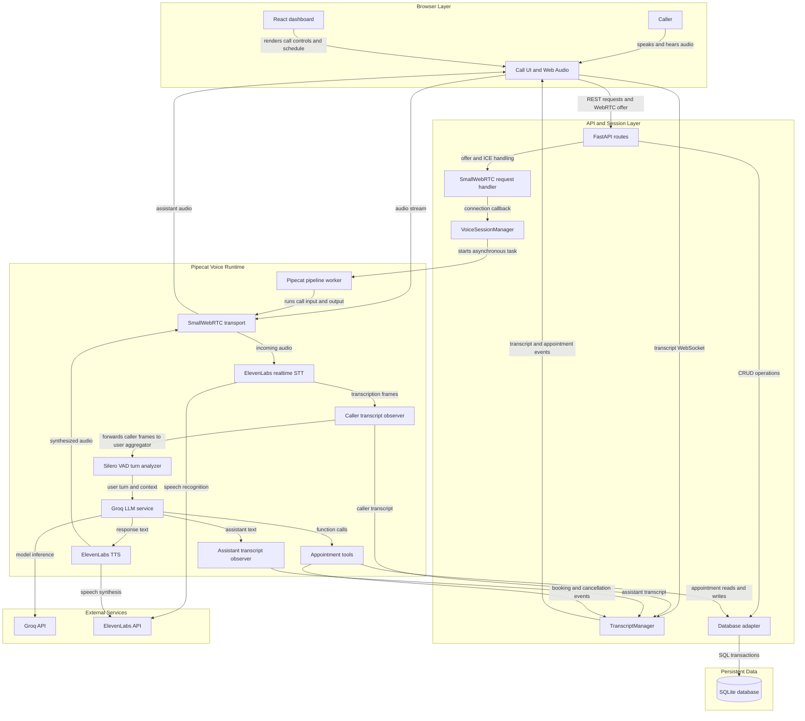
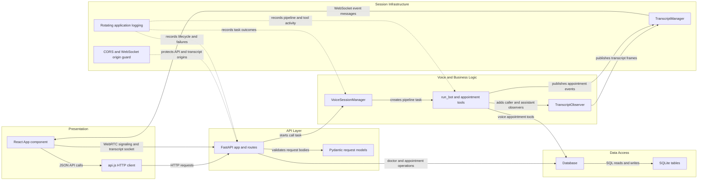
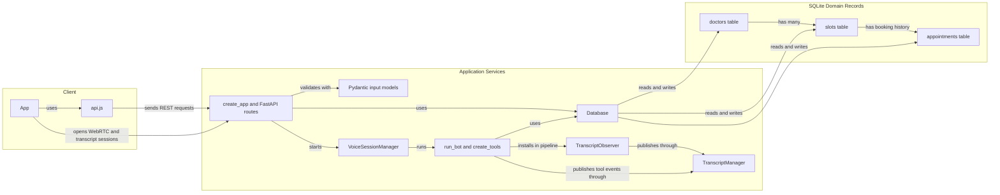
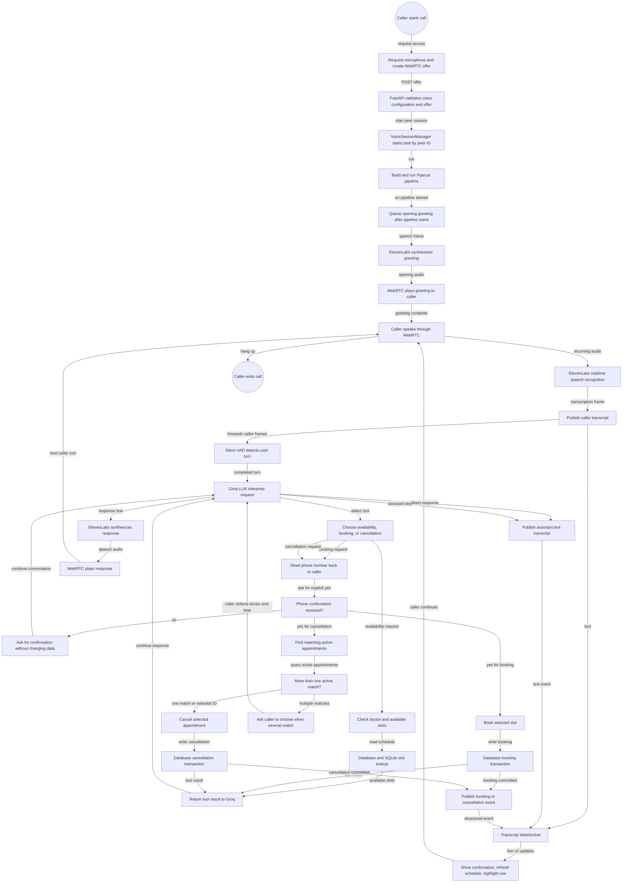

# Architecture Diagram

VoiceAIDoctor is a React dashboard backed by a FastAPI service and a Pipecat WebRTC voice pipeline. This document maps its application layers, component and class relationships, call flow, and speech-processing path.

## Application Architecture

<!-- mermaid-checked: no \n, no em-dash/en-dash, no {} in labels, subgraphs are id["label"], arrows are -->|"label"|, all subgraphs closed by end, ids unique -->

### Technology Stack Summary

| Layer | Technology | Version | Purpose |
|---|---|---|---|
| Browser UI | React | `^19.0.0` | Dashboard, appointment management, and call screen |
| Frontend build | Vite | `^6.0.0` | Development server and production bundle |
| Browser audio | WebRTC and Web Audio API | Browser APIs | Microphone, speaker, peer connection, and local waveform |
| Backend runtime | Python | `>=3.11` | API and voice-pipeline runtime |
| HTTP and WebSocket API | FastAPI | `>=0.115` | Dashboard data, appointment routes, WebRTC signaling, and transcript socket |
| Voice orchestration | Pipecat | `>=1.17,<2` | Pipeline workers, service adapters, tool calling, and VAD integration |
| Speech recognition and synthesis | ElevenLabs | Provider API | Realtime STT and TTS |
| Language model | Groq `openai/gpt-oss-20b` | Configured model ID | Conversation and appointment-tool selection |
| Voice activity detection | Silero VAD | Pipecat integration | User-turn detection with a configured 0.4 second stop interval |
| Persistence | SQLite | Python standard library | Doctors, slots, appointments, and cancellation history |
| ASGI server | Uvicorn | `>=0.32` | Runs the FastAPI application |

### Data Storage and External Services

The `Database` adapter stores clinic data in SQLite tables for doctors, slots, and appointments. FastAPI routes and voice tools share the same adapter; booking and cancellation use database transactions, and a partial unique index prevents more than one active booking per slot. There is no cache or message broker. Transcript and appointment-update events are broadcast over the active WebSocket session and are not persisted as transcript history. Groq provides the LLM, ElevenLabs provides STT and TTS, and Silero VAD runs in the Pipecat pipeline.

### Key Architectural Decisions

- The dashboard and voice tools use one SQLite-backed `Database` abstraction, keeping schedule updates consistent across REST and voice interactions.
- `VoiceSessionManager` owns asynchronous pipeline tasks by WebRTC peer ID and cancels outstanding tasks during application shutdown.
- Transcript clients are isolated by session, origin-checked, and sent updates concurrently with a one-second timeout; application logs rotate at 5 MB with three backups.

## Component Relationships

<!-- mermaid-checked: no \n, no em-dash/en-dash, no {} in labels, subgraphs are id["label"], arrows are -->|"label"|, all subgraphs closed by end, ids unique -->

### Component Inventory

| Component | Layer | Type | Responsibility |
|---|---|---|---|
| `App` | Presentation | React component | Dashboard state, call lifecycle, WebRTC, transcript handling, and appointment feedback |
| `api.js` | Presentation | HTTP client module | Sends JSON requests to the configured backend origin and surfaces API errors |
| FastAPI app | API | Application factory and route handlers | Validates requests, serves dashboard data, handles WebRTC signaling, and accepts transcript sockets |
| Pydantic request models | API | Validation models | Constrain doctor, slot, booking, cancellation, offer, and ICE-candidate input |
| `VoiceSessionManager` | Business logic | Async task manager | Starts one voice task per peer ID and manages task shutdown |
| `run_bot` | Voice runtime | Pipeline factory and runner | Configures Pipecat, registers tools, queues the greeting, and runs the call worker |
| `TranscriptObserver` | Voice runtime | Pipecat frame processor | Publishes caller transcription frames and assistant text frames |
| `Database` | Data access | SQLite adapter | Initializes schema and performs doctor, slot, booking, and cancellation operations |
| `TranscriptManager` | Infrastructure | WebSocket broadcaster | Sends session-scoped transcript and appointment events and removes slow clients |
| Origin guard and logging | Infrastructure | Middleware and cross-cutting services | Restricts browser origins and records application, session, and pipeline lifecycle events |

## Class Diagram

This class and domain relationship view uses the supported flowchart notation. Solid arrows show ownership or use; the labels describe the relationship.

<!-- mermaid-checked: no \n, no em-dash/en-dash, no {} in labels, subgraphs are id["label"], arrows are -->|"label"|, all subgraphs closed by end, ids unique -->

### Class and Domain Inventory

| Class or record | Kind | Key relationship |
|---|---|---|
| `App` | React function component | Uses `api.js`; owns client-side call and dashboard state |
| `api.js` | JavaScript module | Sends REST requests to FastAPI; the component also opens WebRTC and WebSocket connections |
| `create_app` | Application factory | Creates the FastAPI app and shared `Database`, `TranscriptManager`, and `VoiceSessionManager` instances |
| Pydantic input models | Request data models | Validate API payloads before route handlers call the database or WebRTC handler |
| `VoiceSessionManager` | Python class | Starts and tracks `run_bot` tasks by peer connection ID |
| `run_bot` and `create_tools` | Python functions | Assemble the Pipecat pipeline and expose availability, booking, and cancellation tools |
| `TranscriptObserver` | Pipecat processor subclass | Publishes caller and assistant text through `TranscriptManager` |
| `TranscriptManager` | Python class | Manages WebSocket clients and broadcasts transcript and appointment events |
| `Database` | Python class | Owns SQLite connection and transaction operations for the domain tables |
| `doctors` | SQLite table | Parent record for doctor availability slots |
| `slots` | SQLite table | Belongs to a doctor and may have appointment history |
| `appointments` | SQLite table | References a slot and stores its booking or cancellation status |

`TranscriptProcessor` is also defined in `transcripts.py`, but the active `run_bot` pipeline currently inserts `TranscriptObserver` instances for caller and assistant frames.

## Call Flow Diagram

<!-- mermaid-checked: no \n, no em-dash/en-dash, no {} in labels, subgraphs are id["label"], arrows are -->|"label"|, all subgraphs closed by end, ids unique -->

## Pipeline Description

1. **Call setup and signaling:** The React call screen requests microphone access, creates an `RTCPeerConnection`, and sends its offer to `POST /api/offer`. FastAPI checks that the Groq and ElevenLabs settings exist, then passes the offer to Pipecat's `SmallWebRTCRequestHandler`. The browser opens a session-scoped transcript WebSocket after receiving the WebRTC answer.
2. **Session lifecycle:** The connection callback asks `VoiceSessionManager` to start `run_bot` using the peer connection ID as the session ID. The manager tracks the asynchronous worker and cancels active workers when the API shuts down.
3. **Opening greeting:** When the Pipecat pipeline starts, its worker queues a `TTSSpeakFrame`. ElevenLabs synthesizes the greeting and the WebRTC transport sends it to the browser before the caller's first turn.
4. **Caller input and turn detection:** Incoming WebRTC audio is transcribed by `ElevenLabsRealtimeSTTService`. A caller `TranscriptObserver` publishes each recognized utterance to `TranscriptManager`. The LLM user aggregator uses `SileroVADAnalyzer` with a 0.4 second stop interval to identify the end of the caller's turn.
5. **Reasoning and tools:** `GroqLLMService` uses the `openai/gpt-oss-20b` model and the receptionist system prompt. It can check doctor availability, book a selected slot, or cancel an appointment. Booking and cancellation require the caller's spoken phone number to be read back and explicitly confirmed; if several appointments match a cancellation, the assistant asks the caller to choose one. Tool database operations run through `asyncio.to_thread` so SQLite work does not block the voice event loop.
6. **Assistant response:** Assistant text is published by a second `TranscriptObserver`, then passed to `ElevenLabsTTSService`. The resulting audio is sent through the WebRTC transport to the browser speaker. Transcript messages are streamed to the active call screen rather than stored as history.
7. **Schedule updates:** After a successful booking or cancellation, the tool publishes a structured appointment event through `TranscriptManager`. The browser displays the confirmation, refreshes the dashboard, and highlights the matching row. The same SQLite database backs both the voice tools and REST dashboard.
8. **Call teardown:** The browser closes its transcript socket, peer connection, and media tracks when the caller ends the call. Pipecat task completion is observed by `VoiceSessionManager`; application shutdown also closes the WebRTC request handler and cancels any remaining pipeline tasks.
